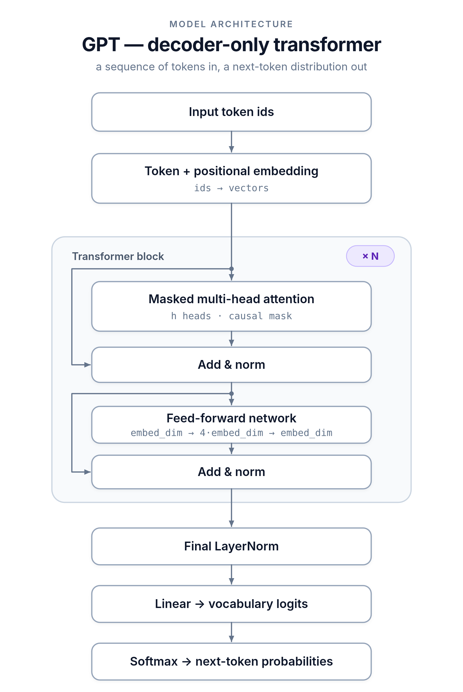

# GPT from Scratch

A GPT-style (decoder-only) language model built from scratch in PyTorch — tokenizer, attention, transformer blocks, training, and generation.

---

## Architecture

The model processes text one stage at a time:

- **BPE Tokenizer** — learns a subword vocabulary and converts text ↔ token ids.
- **Token Embedding + Positional Encoding** — turns ids into learnable vectors and adds a position signal (attention is otherwise order-blind).
- **Transformer Block (× N)** — the repeatable unit, each with:
  - **Causal Multi-Head Attention** — tokens attend to earlier tokens; multiple heads capture different relationships, and a causal mask prevents looking ahead.
  - **Feed-Forward (MLP)** — a per-token network (`embed_dim → 4·embed_dim → embed_dim`).
  - **LayerNorm + residual connections** around each sublayer (pre-norm).
- **Final LayerNorm → Output Head** — a linear layer producing a score (logit) for every token in the vocabulary.
- **Softmax → next token** — sample the prediction, append it, and repeat.

It's **decoder-only** (like GPT): no encoder.

<p align="center">
  
</p>

---

## How to run

### 1. Setup

```bash
python -m venv .venv
source .venv/bin/activate          
pip install -r requirements.txt
```

### 2. Add training data

Put a plain UTF-8 text file at `data/input.txt`. For example, tiny-shakespeare:

```bash
mkdir -p data
curl -o data/input.txt https://raw.githubusercontent.com/karpathy/char-rnn/master/data/tinyshakespeare/input.txt
```

### 3. Train

```bash
python main.py
```

Override any setting from the command line (falls back to the config otherwise):

```bash
python main.py --steps 5000 --lr 1e-4
python main.py --embed_dim 256 --num_layers 6
python main.py --help
```

Weights are saved to `weights/gpt.pt`.

### 4. Generate

```bash
python generate.py
python generate.py --prompt "To be, or not to be"
python generate.py --temperature 0.5 --top_k 50
python generate.py --help
```

> Run everything from the project root so imports resolve. Training uses CUDA automatically if available, otherwise CPU.