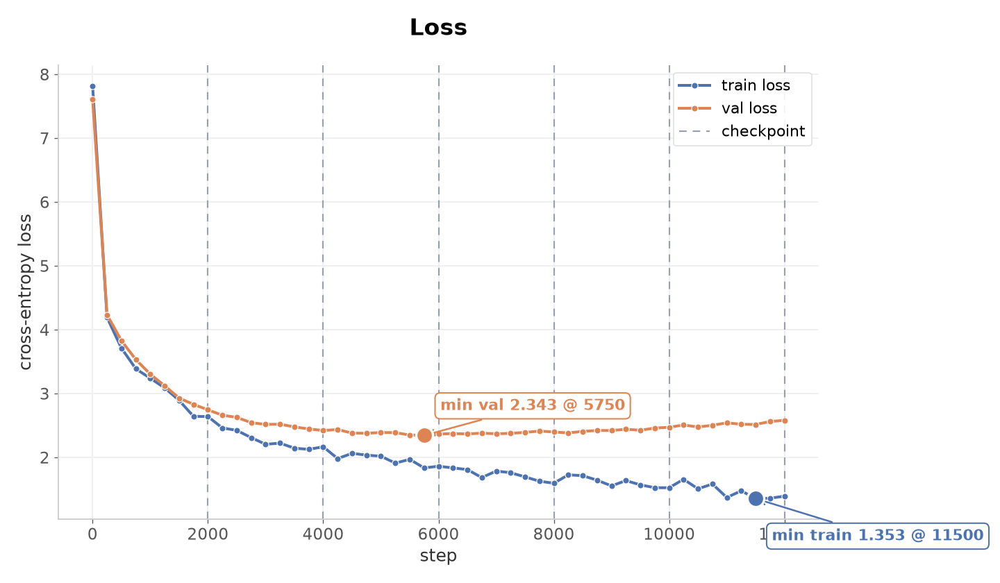
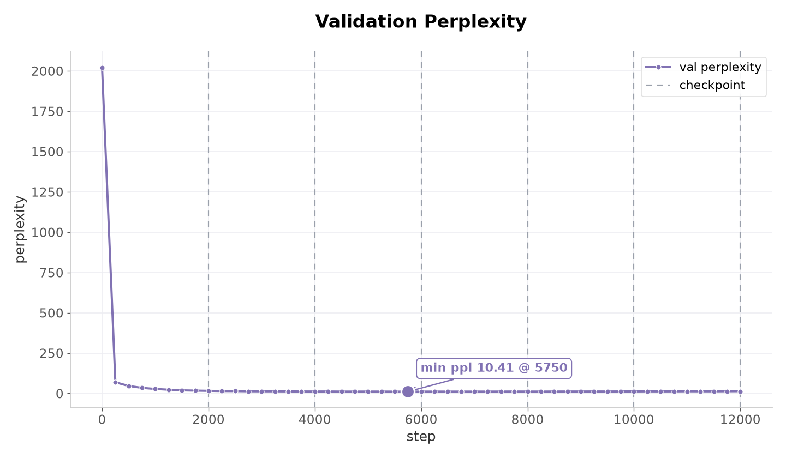
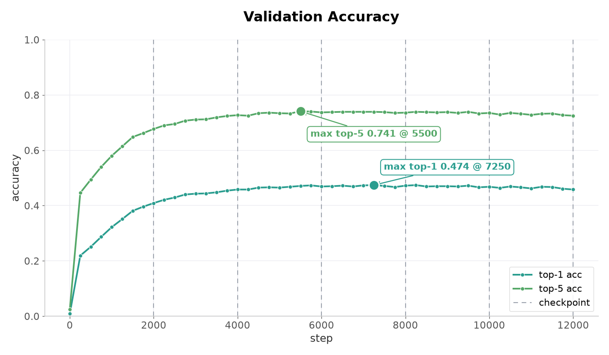

# GPT from Scratch

A GPT-style (decoder-only) language model built from scratch in PyTorch — tokenizer, attention, transformer blocks, training, and generation. The architecture is based on the Transformer introduced in *Attention Is All You Need* (Vaswani et al., 2017).


## Architecture

The model processes text one stage at a time:

- **BPE Tokenizer** — learns a subword vocabulary and converts text ↔ token ids.
- **Token Embedding + Positional Encoding** — turns ids into learnable vectors and adds a position signal (attention is otherwise order-blind).
- **Transformer Block (× N)** — the repeatable unit, each with:
  - **Causal Multi-Head Attention** — tokens attend to earlier tokens; multiple heads capture different relationships, and a causal mask prevents looking ahead.
  - **Feed-Forward (MLP)** — a per-token network (`embed_dim → 4·embed_dim → embed_dim`).
  - **LayerNorm + residual connections** around each sublayer (pre-norm).
- **Final LayerNorm → Output Head** — a linear layer producing a score (logit) for every token in the vocabulary.
- **Softmax → next token** — sample the prediction, append it, and repeat.

It's **decoder-only** (like GPT): no encoder.

<p align="center">
  
</p>

---

## How to run

### 1. Setup

```bash
python -m venv .venv
source .venv/bin/activate          
pip install -r requirements.txt
```

### 2. Add training data

Put a plain UTF-8 text file at `data/input.txt`. For example, tiny-shakespeare:

```bash
mkdir -p data
curl -o data/input.txt https://raw.githubusercontent.com/karpathy/char-rnn/master/data/tinyshakespeare/input.txt
```

### 3. Train

```bash
python train.py
```

Override any setting from the command line (falls back to the config otherwise):

```bash
python train.py --steps 5000 --lr 1e-4
python train.py --embed_dim 256 --num_layers 6
python train.py --help
```

Resume from a saved checkpoint instead of starting fresh:

```bash
python train.py --resume                          # continue from weights/gpt.pt
python train.py --resume --weights_name gpt_3.pt  # continue from a specific checkpoint
```

Weights are saved to `weights/gpt.pt`.

### 4. Generate

```bash
python generate.py
python generate.py --prompt "To be, or not to be"
python generate.py --temperature 0.5 --top_k 50
python generate.py --help
```

> Run everything from the project root so imports resolve. Training uses CUDA automatically if available, otherwise CPU.

---

## Evaluation

The model was trained on a corpus of **4,872,751 tokens** with a tokenizer vocabulary of **2,096**. Every 250 steps we logged training and validation loss, validation perplexity, and top-1 / top-5 next-token accuracy, saving a checkpoint every 2,000 steps.

**Dataset:** trained on [TinyStories](https://huggingface.co/datasets/roneneldan/TinyStories) — a collection of short, simple stories written with a small vocabulary, designed for training compact language models.


 The full set of hyperparameters used for this run:

<div align="center">

<table>
  <tr><th colspan="2">Tokenizer</th></tr>
  <tr><td>BPE merges</td><td>2,000</td></tr>
  <tr><th colspan="2">Model</th></tr>
  <tr><td>Embedding dimension</td><td>384</td></tr>
  <tr><td>Attention heads</td><td>6</td></tr>
  <tr><td>Transformer layers</td><td>6</td></tr>
  <tr><td>Max context length</td><td>256</td></tr>
  <tr><th colspan="2">Training</th></tr>
  <tr><td>Sequence length</td><td>256</td></tr>
  <tr><td>Batch size</td><td>32</td></tr>
  <tr><td>Learning rate</td><td>3e-4</td></tr>
  <tr><td>Steps</td><td>20,000</td></tr>
  <tr><td>Checkpoint interval</td><td>2,000</td></tr>
  <tr><th colspan="2">Evaluation</th></tr>
  <tr><td>Validation fraction</td><td>0.1</td></tr>
  <tr><td>Eval interval</td><td>250</td></tr>
  <tr><td>Eval batches</td><td>20</td></tr>
  <tr><th colspan="2">Runtime</th></tr>
  <tr><td>Device</td><td>CUDA (CPU fallback)</td></tr>
</table>

</div>

### Results

<p align="center">
  <br>
  <em>Training vs validation cross-entropy loss. Training loss keeps dropping while validation loss flattens and then slowly drifts upward.</em>
</p>

<p align="center">
  <br>
  <em>Validation perplexity — our primary metric. It bottoms out mid-run and then begins to climb.</em>
</p>

<p align="center">
  <br>
  <em>Validation top-1 and top-5 accuracy, which plateau around 0.47 and 0.74.</em>
</p>

> **Why we stopped early.**
> Perplexity was the main metric we tracked, and after a certain point it started going **up** instead of down. Rather than keep training, we selected **checkpoint 4 (step 8,000)** as our final model and stopped early. The training loss was still going down past that point — but with validation perplexity rising at the same time, that's most likely **overfitting** rather than real improvement, so the later weights were discarded.

### Run summary

<div align="center">

<table>
  <tr><th>Metric</th><th>Value</th><th>Step</th></tr>
  <tr><td>Device</td><td>cuda</td><td>—</td></tr>
  <tr><td>Train tokens</td><td>4,872,751</td><td>—</td></tr>
  <tr><td>Vocabulary size</td><td>2,096</td><td>—</td></tr>
  <tr><td>Logged steps</td><td>0 – 12,000</td><td>—</td></tr>
  <tr><td>Checkpoints saved</td><td>6</td><td>—</td></tr>
  <tr><td>Best validation loss</td><td>2.3426</td><td>5,750</td></tr>
  <tr><td>Minimum perplexity</td><td>10.41</td><td>5,750</td></tr>
  <tr><td>Best top-1 accuracy</td><td>0.474</td><td>7,250</td></tr>
  <tr><td>Best top-5 accuracy</td><td>0.741</td><td>5,500</td></tr>
  <tr><td><b>Selected checkpoint</b></td><td><b>gpt_3.pt</b></td><td><b>6,000</b></td></tr>
</table>

</div>

### Full training log

<div align="center">

<table>
  <tr>
    <th>Step</th><th>Train loss</th><th>Val loss</th><th>Val ppl</th><th>Top-1 acc</th><th>Top-5 acc</th><th>Checkpoint</th>
  </tr>
  <tr><td>0</td><td>7.8190</td><td>7.6116</td><td>2021.44</td><td>0.009</td><td>0.024</td><td></td></tr>
  <tr><td>250</td><td>4.1903</td><td>4.2318</td><td>68.84</td><td>0.219</td><td>0.446</td><td></td></tr>
  <tr><td>500</td><td>3.7094</td><td>3.8267</td><td>45.91</td><td>0.251</td><td>0.494</td><td></td></tr>
  <tr><td>750</td><td>3.3853</td><td>3.5300</td><td>34.12</td><td>0.287</td><td>0.540</td><td></td></tr>
  <tr><td>1000</td><td>3.2380</td><td>3.3020</td><td>27.17</td><td>0.322</td><td>0.580</td><td></td></tr>
  <tr><td>1250</td><td>3.0867</td><td>3.1203</td><td>22.65</td><td>0.351</td><td>0.614</td><td></td></tr>
  <tr><td>1500</td><td>2.8917</td><td>2.9274</td><td>18.68</td><td>0.381</td><td>0.648</td><td></td></tr>
  <tr><td>1750</td><td>2.6406</td><td>2.8288</td><td>16.93</td><td>0.396</td><td>0.662</td><td></td></tr>
  <tr><td>2000</td><td>2.6380</td><td>2.7433</td><td>15.54</td><td>0.409</td><td>0.677</td><td>gpt_1.pt</td></tr>
  <tr><td>2250</td><td>2.4595</td><td>2.6591</td><td>14.28</td><td>0.421</td><td>0.690</td><td></td></tr>
  <tr><td>2500</td><td>2.4217</td><td>2.6250</td><td>13.80</td><td>0.429</td><td>0.695</td><td></td></tr>
  <tr><td>2750</td><td>2.3078</td><td>2.5425</td><td>12.71</td><td>0.440</td><td>0.707</td><td></td></tr>
  <tr><td>3000</td><td>2.2035</td><td>2.5149</td><td>12.37</td><td>0.443</td><td>0.711</td><td></td></tr>
  <tr><td>3250</td><td>2.2215</td><td>2.5181</td><td>12.40</td><td>0.444</td><td>0.712</td><td></td></tr>
  <tr><td>3500</td><td>2.1423</td><td>2.4763</td><td>11.90</td><td>0.448</td><td>0.719</td><td></td></tr>
  <tr><td>3750</td><td>2.1244</td><td>2.4436</td><td>11.51</td><td>0.454</td><td>0.724</td><td></td></tr>
  <tr><td>4000</td><td>2.1645</td><td>2.4193</td><td>11.24</td><td>0.458</td><td>0.727</td><td>gpt_2.pt</td></tr>
  <tr><td>4250</td><td>1.9796</td><td>2.4348</td><td>11.41</td><td>0.458</td><td>0.725</td><td></td></tr>
  <tr><td>4500</td><td>2.0618</td><td>2.3784</td><td>10.79</td><td>0.465</td><td>0.734</td><td></td></tr>
  <tr><td>4750</td><td>2.0337</td><td>2.3761</td><td>10.76</td><td>0.466</td><td>0.736</td><td></td></tr>
  <tr><td>5000</td><td>2.0170</td><td>2.3883</td><td>10.89</td><td>0.465</td><td>0.734</td><td></td></tr>
  <tr><td>5250</td><td>1.9084</td><td>2.3860</td><td>10.87</td><td>0.468</td><td>0.733</td><td></td></tr>
  <tr><td>5500</td><td>1.9678</td><td>2.3486</td><td>10.47</td><td>0.471</td><td>0.741</td><td></td></tr>
  <tr><td>5750</td><td>1.8330</td><td>2.3426</td><td>10.41</td><td>0.473</td><td>0.740</td><td></td></tr>
  <tr><td>6000</td><td>1.8602</td><td>2.3637</td><td>10.63</td><td>0.469</td><td>0.737</td><td><b>gpt_3.pt</b></td></tr>
  <tr><td>6250</td><td>1.8333</td><td>2.3714</td><td>10.71</td><td>0.470</td><td>0.738</td><td></td></tr>
  <tr><td>6500</td><td>1.8075</td><td>2.3658</td><td>10.65</td><td>0.472</td><td>0.739</td><td></td></tr>
  <tr><td>6750</td><td>1.6823</td><td>2.3779</td><td>10.78</td><td>0.469</td><td>0.739</td><td></td></tr>
  <tr><td>7000</td><td>1.7844</td><td>2.3681</td><td>10.68</td><td>0.473</td><td>0.739</td><td></td></tr>
  <tr><td>7250</td><td>1.7581</td><td>2.3753</td><td>10.75</td><td>0.474</td><td>0.739</td><td></td></tr>
  <tr><td>7500</td><td>1.6931</td><td>2.3899</td><td>10.91</td><td>0.471</td><td>0.738</td><td></td></tr>
  <tr><td>7750</td><td>1.6253</td><td>2.4104</td><td>11.14</td><td>0.467</td><td>0.735</td><td></td></tr>
  <tr><td><b>8000</b></td><td><b>1.5931</b></td><td><b>2.3966</b></td><td><b>10.99</b></td><td><b>0.472</b></td><td><b>0.736</b></td><td><b>gpt_4.pt</b></td></tr>
  <tr><td>8250</td><td>1.7250</td><td>2.3813</td><td>10.82</td><td>0.474</td><td>0.739</td><td></td></tr>
  <tr><td>8500</td><td>1.7122</td><td>2.4061</td><td>11.09</td><td>0.469</td><td>0.738</td><td></td></tr>
  <tr><td>8750</td><td>1.6410</td><td>2.4195</td><td>11.24</td><td>0.470</td><td>0.737</td><td></td></tr>
  <tr><td>9000</td><td>1.5519</td><td>2.4194</td><td>11.24</td><td>0.470</td><td>0.738</td><td></td></tr>
  <tr><td>9250</td><td>1.6347</td><td>2.4389</td><td>11.46</td><td>0.469</td><td>0.735</td><td></td></tr>
  <tr><td>9500</td><td>1.5682</td><td>2.4239</td><td>11.29</td><td>0.472</td><td>0.739</td><td></td></tr>
  <tr><td>9750</td><td>1.5237</td><td>2.4574</td><td>11.67</td><td>0.466</td><td>0.733</td><td></td></tr>
  <tr><td>10000</td><td>1.5228</td><td>2.4703</td><td>11.83</td><td>0.468</td><td>0.735</td><td>gpt_5.pt</td></tr>
  <tr><td>10250</td><td>1.6555</td><td>2.5056</td><td>12.25</td><td>0.464</td><td>0.729</td><td></td></tr>
  <tr><td>10500</td><td>1.5059</td><td>2.4743</td><td>11.87</td><td>0.469</td><td>0.735</td><td></td></tr>
  <tr><td>10750</td><td>1.5815</td><td>2.5011</td><td>12.20</td><td>0.466</td><td>0.732</td><td></td></tr>
  <tr><td>11000</td><td>1.3701</td><td>2.5403</td><td>12.68</td><td>0.462</td><td>0.728</td><td></td></tr>
  <tr><td>11250</td><td>1.4748</td><td>2.5172</td><td>12.39</td><td>0.468</td><td>0.732</td><td></td></tr>
  <tr><td>11500</td><td>1.3528</td><td>2.5140</td><td>12.35</td><td>0.467</td><td>0.733</td><td></td></tr>
  <tr><td>11750</td><td>1.3587</td><td>2.5602</td><td>12.94</td><td>0.461</td><td>0.727</td><td></td></tr>
  <tr><td>12000</td><td>1.3908</td><td>2.5789</td><td>13.18</td><td>0.458</td><td>0.725</td><td>gpt_6.pt</td></tr>
</table>

</div>
